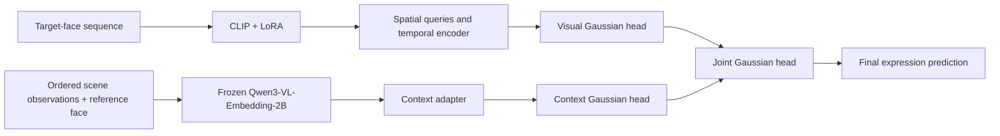

# SSDF: Source-Supervised Decision Fusion for Dynamic Facial Expression Recognition

This repository contains the SSDF model architecture, its source-supervised heads, frozen Qwen context extraction from prepared observations, and an input loader. It accompanies the SSDF paper.

## Method at a glance

SSDF reads a target person's face sequence and a separate frozen representation of the wider video. The face pathway learns spatial and temporal features with a CLIP-based encoder. The contextual pathway adapts one precomputed multimodal embedding. Separate visual and contextual Gaussian heads receive direct expression supervision; a joint Gaussian head combines both sources for the final prediction.

The model definition is in [`ssdf/model.py`](ssdf/model.py). [`ssdf/context.py`](ssdf/context.py) shows how ordered observations and a reference face enter frozen Qwen, and how the final valid token becomes the normalized context vector. [`ssdf/data.py`](ssdf/data.py) loads a prepared face sequence and its cached context vector. [`METHOD.md`](METHOD.md) explains the two pathways and the source-supervised objective.

[`CODE_GUIDE.md`](CODE_GUIDE.md) maps the main components to their code locations.

## Dependencies

[`requirements.txt`](requirements.txt) lists the libraries used by these modules with Python 3.11 or newer. The Qwen embedder object and model weights are supplied separately by the caller.

## Repository contents

The code covers CLIP adaptation, spatial query reading, temporal aggregation, frozen Qwen context extraction, prepared-input loading, and the visual, contextual, and joint Gaussian heads. The Qwen module accepts prepared observations, a reference face, timing metadata, and task text. The loader accepts selected face frames and a paired cached vector.

Dataset preparation, training, evaluation, and model weights are outside this repository. Experimental protocols and results are described in the paper.

## Citation

Please cite the SSDF manuscript when its bibliographic details are available.
